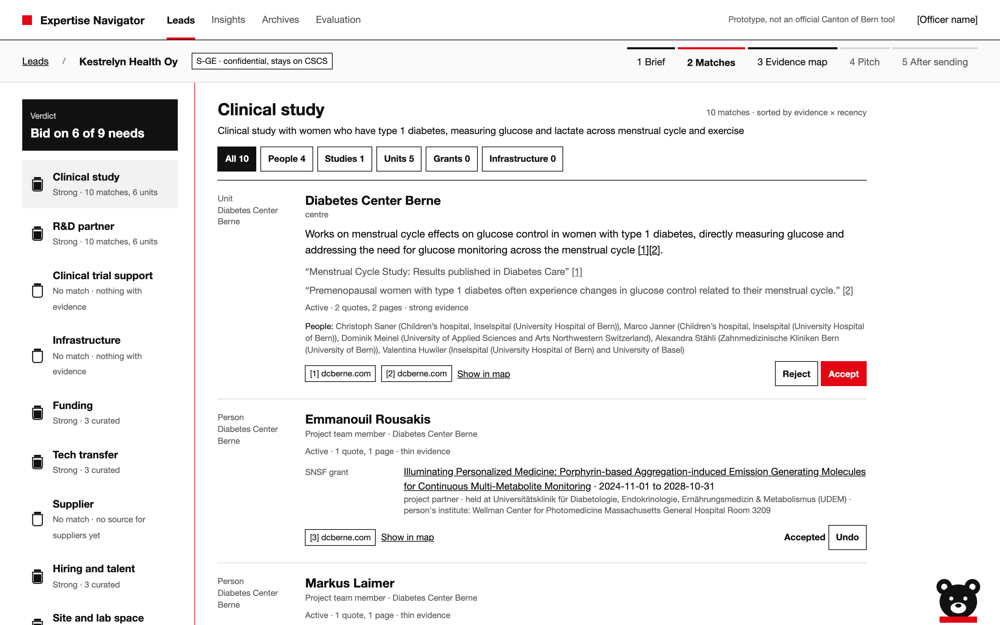
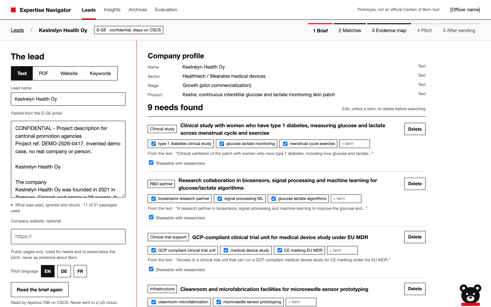
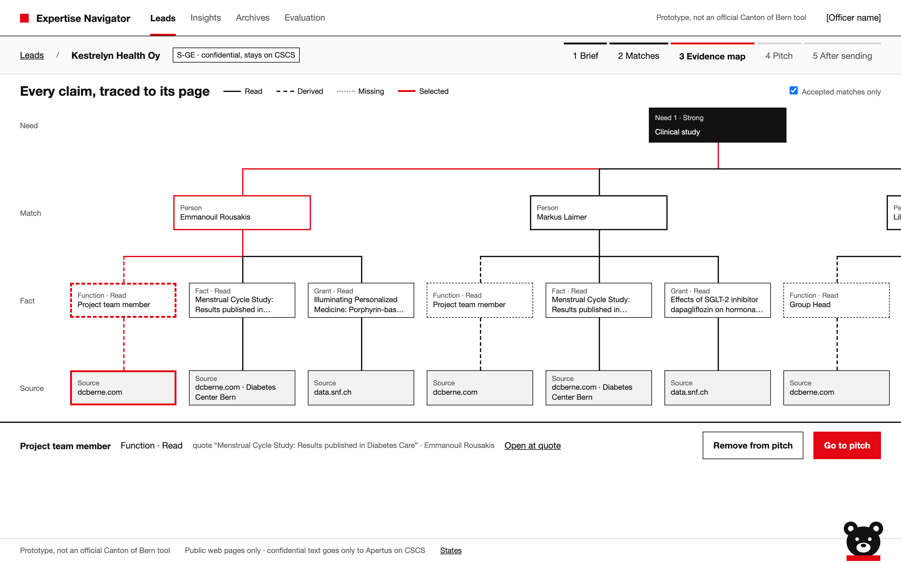

<p align="center">
  <picture>
    <source media="(prefers-color-scheme: dark)" srcset="docs/brand/bern-agency-on-dark.png" />
    
  </picture>
  &nbsp;&nbsp;&nbsp;&nbsp;
  <picture>
    <source media="(prefers-color-scheme: dark)" srcset="docs/brand/apertus-on-dark.png" />
    
  </picture>
  &nbsp;&nbsp;&nbsp;&nbsp;
  <picture>
    <source media="(prefers-color-scheme: dark)" srcset="docs/brand/huggingface-on-dark.png" />
    
  </picture>
  &nbsp;&nbsp;&nbsp;&nbsp;
  <picture>
    <source media="(prefers-color-scheme: dark)" srcset="docs/brand/sprintd-on-dark.svg" />
    
  </picture>
</p>

<h1 align="center">mutz</h1>

<p align="center">From a company's one pager to the right experts in Bern, every claim traced to its page.</p>

<p align="center">Built for the Bern Economic Development Agency case <i>Research &amp; Expertise Navigator</i> at «Hack Apertus» Liebefeld 2026.</p>

A company wants to settle in Bern and sends a description of what it needs: a clinical study, an R&D
partner, a cleanroom. The officer at the agency then has to know which of hundreds of institute,
group and centre websites to look at, and the company's words ("glucose sensors") are rarely the
words on those pages ("continuous glucose monitoring", "biosensing", "CGM").

mutz crawls the public pages of the University of Bern, ARTORG and the Diabetes Center Berne once,
turns them into a knowledge graph of people, units, projects and infrastructure, and searches it in
plain language. Paste a one pager and you get ranked researchers, labs and infrastructure per need,
each with a plain reason, the quote it rests on and a link to the page. Then build a pitch for the
company from the matches you accept. Everything runs on Apertus, hosted in Switzerland. The rule we
built it around: **Apertus reads and writes, code checks every quote, the officer decides.**

<p align="center">
  
</p>
<p align="center">
  
  
</p>

## What it does

- **Reads the company brief.** Paste text, upload a PDF, give a website or type keywords. Apertus
  70B turns it into a company profile and typed needs (clinical study, R&D partner, infrastructure,
  funding, tech transfer, talent, ...). Every passage is marked used, ignored or struck, and every
  need points back at the sentence it came from.
- **Keeps confidential parts local.** Revenue, shareholders, salaries, contact data and anything
  that reads like an instruction to an AI are struck on this machine before the rest goes to
  Apertus. Keyword mode sends nothing at all.
- **Finds experts, not pages.** BM25 and BGE-M3 dense retrieval in DE, EN and FR, with lay term
  expansions from Apertus 70B, a local cross encoder and an Apertus 70B judge. Chunks are voted up
  to people and units, weighted by seniority and how recently the work was active.
- **Says when Bern has nothing.** A need with no strong evidence gets "no match" and the list of
  sources it searched, not a weak guess. Supplier style needs are marked "not covered yet".
- **Cites everything.** A fact only enters the knowledge graph if its quote is really on the page
  and names the person or unit. Results show the quotes and numbered source links, and the
  evidence map draws need → match → fact → source page for every claim.
- **Is fair to small groups.** Results are capped per unit, so one big institute can't fill the
  top 10, and the evaluation tracks how exposure spreads across units.
- **Adds SNSF grants and curated offers.** Grants from the SNSF open data are joined to people
  only when the match is unambiguous, and the rule used is shown. Funding, transfer and talent
  needs are answered from a checked list of Bern programmes.
- **Drafts the pitch.** Accepted matches become an A4 pitch in EN, DE or FR. Apertus writes each
  card only from that card's own quotes; if the text fails the checks, the card falls back to the
  quote itself. Cards can be made shorter, less technical or German, and the clean PDF only leaves
  once every card is ticked. A Review PDF keeps the officer's notes and the evidence appendix.
- **Follows up.** Outreach to the researchers, a draft visit day with an `.ics` file, re-evaluation
  when the company sends more information, and lead stages from new to won or lost.
- **Shows the gaps.** Insights lists what leads asked for that Bern could not answer, and where
  Bern is strong, thin or absent against that demand.
- **Mutz, the bear.** An Apertus 70B assistant in the corner that uses the same functions as the
  UI. It can search, explain a rank and open a source; anything that changes the pitch waits for
  a click. If the gateway fails, a rule based path answers from the same tools.

## How well it works

About 3,000 pages from 16 sites (ARTORG, DCB and 14 UniBE institutes). On our gold set (84 cases,
55 dev, 29 held out and hash locked; the held out split was run once, after the freeze):

| | mutz, held out | mutz, dev | keyword baseline, dev |
|---|---|---|---|
| Recall@10 (target ≥ 80%) | 89% | 88% | 54% |
| Questions with a right expert in the top 10 | 91% (21 of 23) | 89% | |
| Quotes found on the cited page | 100% | 100% | 100% |
| Required fields filled where the source has them | 100% | 100% | 100% |

Recall@10 only says whether the groups we picked come back in the top 10, not whether a company would
find them useful. The full numbers, by source and by query type, with synonym parity and exposure, are
in [docs/eval.md](docs/eval.md) and on the Evaluation screen.

## Try it

The live demo is at https://mutz-117983845448.europe-west6.run.app (login `mutz` / `bearlikeshoney`).
Or run it yourself with one command; the image has the crawled data and the search models inside:

```bash
docker run -p 8000:8000 -e KEERA_API_KEY=... ghcr.io/besaif/mutz
```

Then open http://localhost:8000. The image is about 2.5 GB and runs on Intel and Apple Silicon.
`scripts/release_image.sh` rebuilds and pushes it.

## Run it locally

You need Python 3.12 and a key for the Keera gateway (Apertus on CSCS).

```bash
python3.12 -m venv .venv && source .venv/bin/activate
pip install torch --index-url https://download.pytorch.org/whl/cpu
pip install -r requirements.txt
echo 'KEERA_API_KEY=...' > .env
```

`data/` is not in the repo, so build it once. The crawl is polite (one request per second per host)
and every gateway call is cached on disk, so reruns cost nothing:

```bash
export CRAWL_CONTACT="you@example.com"      # goes into the crawler's User-Agent
python crawl.py                             # snapshot to data/raw/
python -m ingest.clean                      # pages and chunks
python -m ingest.extract                    # facts, rules + Apertus 8B + verifier (--no-llm for rules only)
python -m ingest.resolve                    # data/kg.sqlite
python -m search.index --download-models    # BGE-M3 and the reranker, once
python -m search.index                      # BM25 + dense index
python -m enrich.snsf download && python -m enrich.snsf build   # optional: SNSF grants
```

Then start the app and open http://localhost:8000:

```bash
uvicorn app.main:app --port 8000
```

Click **Load the sport wearable demo** for an invented test company, or **New lead** to paste your
own. Or run it all in Docker with `docker compose up --build`; it mounts `data/` and caches the models
in a volume.

No index yet? Set `MUTZ_STUB=all` and the app runs on stubs, so the screens still work.

## Under the hood

- `crawl.py`: the crawler. Adding a site is one entry in a sources file
  (`python crawl.py --config config/sources.json`); UniBE sites come from `inventory/unibe_seeds.txt`.
- `ingest/`: clean and chunk, extract facts, verify quotes, resolve people into `data/kg.sqlite`
  ([schema](ingest/SCHEMA.md)).
- `search/`: hybrid index and `query()`. `python -m search.query --why-not "Name" "query"` explains
  why someone was not in the top 10, from the RankLog.
- `needs/`: company input → profile and typed needs. `enrich/`: SNSF grants and curated offers.
- `pitch/`: the A4 pitch PDF (WeasyPrint). `app/`: FastAPI with Jinja screens, Mutz and the pitch drafts.
- `common/llm.py`: the one Apertus client, with the disk cache, retries and a token log.
- `eval/`: gold set, metrics and synthetic queries. `python -m eval.run_eval`.
- Tests: `python -m pytest -q` in any module, for example `python -m pytest search/tests -q`.
- Embeddings and reranking run on this machine; the only outbound calls go to Apertus. The
  commented `vllm` service in `docker-compose.yml` runs Apertus 70B yourself, for a fully air
  gapped setup.
- [docs/requirements.md](docs/requirements.md): what the case asks for. [docs/DESIGN.md](docs/DESIGN.md):
  the Canton of Bern look. [docs/gateway.md](docs/gateway.md): the Keera gateway notes.

Prototype, not an official Canton of Bern tool. Public web pages only; the content stays with the
institutions.
