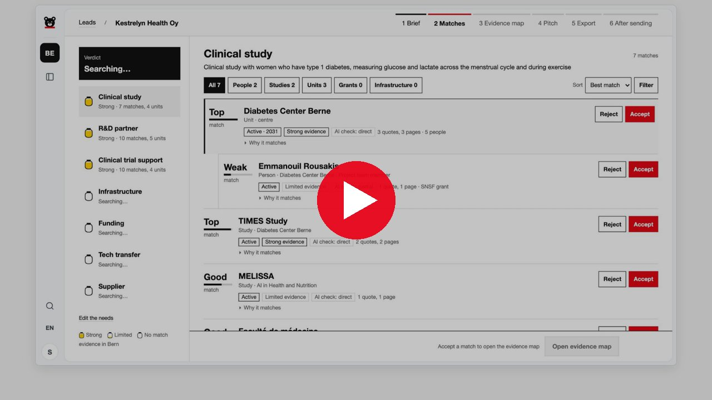

<p align="center">
  <picture>
    <source media="(prefers-color-scheme: dark)" srcset="docs/brand/bern-agency-on-dark.png" />
    
  </picture>
  &nbsp;&nbsp;&nbsp;&nbsp;
  <picture>
    <source media="(prefers-color-scheme: dark)" srcset="docs/brand/apertus-on-dark.png" />
    
  </picture>
  &nbsp;&nbsp;&nbsp;&nbsp;
  <picture>
    <source media="(prefers-color-scheme: dark)" srcset="docs/brand/huggingface-on-dark.png" />
    
  </picture>
  &nbsp;&nbsp;&nbsp;&nbsp;
  <picture>
    <source media="(prefers-color-scheme: dark)" srcset="docs/brand/sprintd-on-dark.svg" />
    
  </picture>
</p>

<h1 align="center">mutz</h1>

<p align="center">From a company's one pager to the right experts in Bern, every claim traced to its page.</p>

<p align="center">
  <a href="https://youtu.be/5ywKrGxzQlk"><b>▶ Demo video</b></a> (4 min) ·
  <a href="docs/media/mutz-slides.pdf"><b>Slides</b></a> (PDF) ·
  <a href="https://mutz-117983845448.europe-west6.run.app"><b>Live demo</b></a> (login <code>mutz</code> / <code>bearlikeshoney</code>) ·
  <a href="LICENSE">MIT License</a>
</p>

<p align="center">
  <a href="https://youtu.be/5ywKrGxzQlk"></a>
</p>

Built for the Bern Economic Development Agency case *Research & Expertise Navigator* at «Hack Apertus» Liebefeld 2026.

## What it is

A company that wants to settle in Bern describes what it needs: a clinical study, an R&D partner, a
cleanroom. mutz crawls the public pages of the University of Bern, ARTORG and the Diabetes Center Berne,
builds a knowledge graph of people, units, projects and infrastructure, and matches each need to ranked
experts. Every match shows a reason, the quote it rests on and a link to the page. Needs with no strong
evidence get "no match" instead of a weak guess. Accepted matches become an A4 pitch in EN, DE or FR.
Everything runs on Apertus, hosted in Switzerland.

**Results** on 23 held-out questions: Recall@10 89% (target ≥ 80%; keyword baseline 54% on dev), and 100% of
quotes found on the cited page. Details in [docs/eval.md](docs/eval.md).

## Run it

```bash
docker run -p 8000:8000 -e KEERA_API_KEY=... ghcr.io/besaif/mutz
```

Open http://localhost:8000. The image (about 2.5 GB) includes the crawled data and search models.

To run from source (Python 3.12):

```bash
python3.12 -m venv .venv && source .venv/bin/activate
pip install torch --index-url https://download.pytorch.org/whl/cpu
pip install -r requirements.txt
echo 'KEERA_API_KEY=...' > .env
uvicorn app.main:app --port 8000
```

`data/` is not in the repo. Build it with `crawl.py`, then `ingest.clean`, `ingest.extract`,
`ingest.resolve` and `search.index`, or set `MUTZ_STUB=all` to run the screens on stubs.

## Layout

`crawl.py` crawler · `ingest/` facts and knowledge graph · `search/` hybrid retrieval · `needs/` brief to
needs · `pitch/` PDF pitch · `app/` FastAPI UI · `eval/` gold set and metrics.

Prototype, not an official Canton of Bern tool. Public web pages only; the content stays with the institutions.
